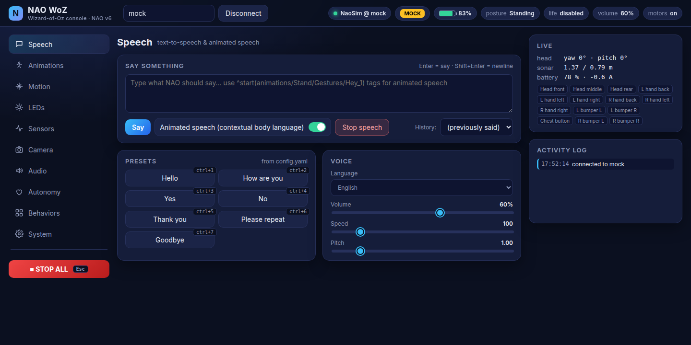
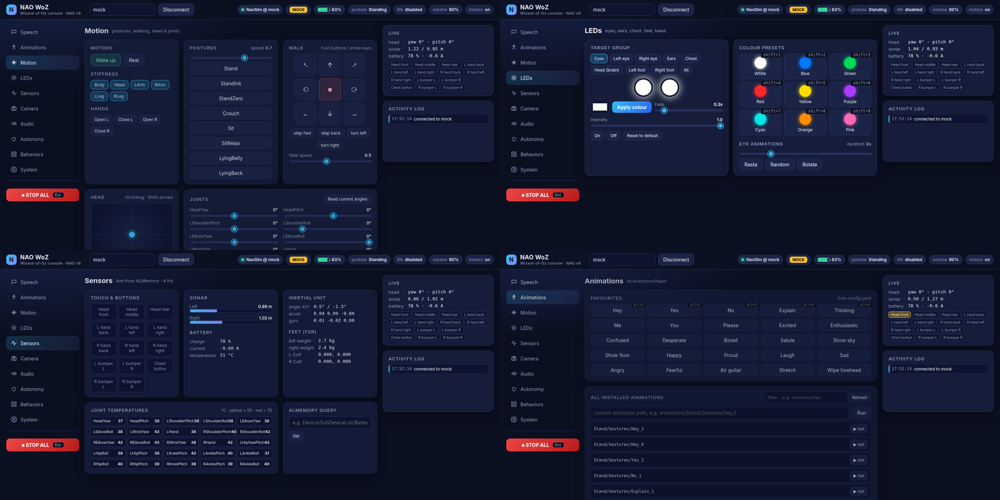
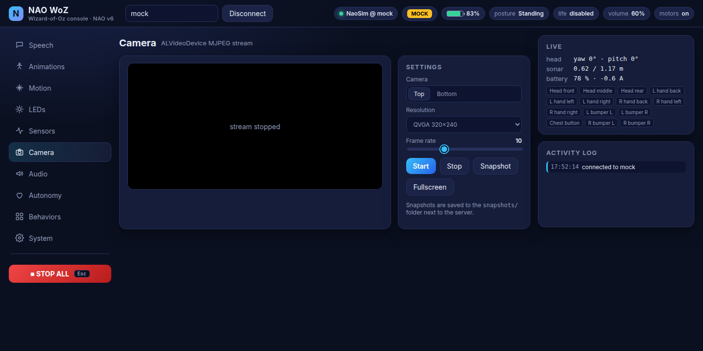

<div align="center">



# NAO WoZ

**A browser-based Wizard-of-Oz control room for the NAO v6 robot.**

One Python 3 process on your laptop · one tab in your browser · every NAOqi feature a wizard needs.


</div>

---

## Contents

- [Why NAO WoZ](#why-nao-woz)
- [Quick start](#quick-start)
- [The console](#the-console)
- [Keyboard shortcuts](#keyboard-shortcuts)
- [Configuration](#configuration)
- [How it is built](#how-it-is-built)
- [REST API](#rest-api)
- [Tips for studies](#tips-for-studies)
- [Troubleshooting](#troubleshooting)

---

## Why NAO WoZ

In a Wizard-of-Oz study the experimenter secretly drives the robot while participants believe it acts on its own.
That needs a control surface that is **fast**, **predictable** and **complete**: one keypress to make the robot
wave, one glance to know it is still standing, one big red button when something goes wrong.

NAO WoZ is that control surface for **NAO v6**. It is inspired by [WoZ4U](https://github.com/frietz58/WoZ4U) for
Pepper, rebuilt for NAO and modern Python.

| | |
|---|---|
| 🧠 **Python 3, no SDK download** | Talks to the robot through the official `qi` wheel from PyPI, so no NAOqi SDK or Python 2.7 is needed. |
| ⌨️ **Hotkeys for everything you rehearse** | Speech lines, gestures and eye colours from `config.yaml` each get a button and an optional shortcut. |
| 📡 **Live telemetry** | Touch sensors, sonar, battery, head pose and an activity log update over a WebSocket while you work. |
| 🧪 **Mock robot** | `--mock` runs a simulated backend with the same interface, perfect for rehearsing or developing on the train. |
| 🛑 **One panic button** | **STOP ALL** (or `Esc`) halts speech, walking, behaviours and audio in one go. |

---

## Quick start

### 1. Install

```bash
conda env create -f environment.yml      # creates the `nao_woz` env (Python 3.11)
conda activate nao_woz
```

Already have the env? Just refresh the pinned packages:

```bash
pip install -r requirements.txt
```

### 2. Run

```bash
./run.sh --mock                           # no robot: try the console with a simulated NAO
./run.sh                                  # real robot: pick the IP in the top bar, press Connect
./run.sh --ip 192.168.1.42 --autoconnect  # connect immediately on start-up
./run.sh --port 9000                      # serve on another port (default 8000)
```

### 3. Open

Go to <http://localhost:8000>.
Press NAO's chest button once and it will say its IP address out loud.

> **Tip:** `run.sh` activates the conda env for you. If you prefer, run `python server.py --mock` directly inside the env.

---

## The console

The interface is a single page. The **left rail** switches between ten panels, the **right rail** always shows
live state (touch map, head angles, sonar, battery) and an activity log of everything the wizard triggered,
including any NAOqi error.

<div align="center">

<sub>Clockwise from top-left: Motion, LEDs, Animations, Sensors. All captured in <code>--mock</code> mode.</sub>
</div>

<br>

| Panel | What you can do |
|---|---|
| 💬 **Speech** | Type-to-speak, animated speech with `^start(...)` tags, presets with hotkeys, language / volume / speed / pitch, history of what was said. |
| 🕺 **Animations** | Favourites from `config.yaml`, a searchable list of *every* animation installed on the robot, run any custom path. |
| 🦿 **Motion** | Wake / rest, stiffness per chain, 8 postures, hold-to-walk D-pad and arrow keys, discrete steps and turns, 2-D head pad, all 25 joint sliders, open / close hands. |
| 💡 **LEDs** | Eyes / ears / chest / feet / brain groups, colour picker, colour presets with hotkeys, fade time, intensity, on / off / reset, rasta / random / rotate eye animations. |
| 📈 **Sensors** | Live (4 Hz) touch and bumpers, sonar, battery, IMU, foot force sensors, 25 joint temperatures, free-form ALMemory query. |
| 📷 **Camera** | MJPEG stream from the top or bottom camera, resolution and frame rate, snapshots saved to disk, fullscreen view. |
| 🔊 **Audio** | Play WAV / MP3 files stored on the robot, master volume, start / stop microphone recording on the robot. |
| 🫀 **Autonomy** | ALAutonomousLife state, basic awareness, engagement / tracking mode, blinking, listening and speaking movements, breathing, fall manager. |
| 🧩 **Behaviors** | List, run and stop any installed behaviour (Choregraphe apps), stop all. |
| ⚙️ **System** | Robot info, reload `config.yaml` without restarting, reboot / shutdown, keyboard cheat-sheet. |

<details>
<summary><b>More screenshots</b> (Camera panel)</summary>
<br>

</details>

---

## Keyboard shortcuts

Shortcuts are active whenever the page has focus and you are not typing in a text field.

| Key | Action |
|---|---|
| `Esc` | **STOP ALL** |
| `Enter` in the speech box | Say the text (`Shift+Enter` inserts a newline) |
| `↑` `↓` `←` `→` (hold) | Walk forward / back, strafe left / right |
| `Q` / `E` (hold) | Turn left / right |
| `Shift` + arrows | Nudge the head |
| `Ctrl` + `Space` | Stop speech |
| `Ctrl+1 …` | Speech presets |
| `Alt+1 …` | Favourite animations |
| `Shift+1 …` | LED colour presets |

Preset shortcuts are whatever you define in `config.yaml`; the System panel lists the ones currently loaded.

---

## Configuration

Everything that should be one click away during a session lives in **`config.yaml`**.
Edit it, then press **Reload config.yaml** in the System panel. No restart needed.

```yaml
robot_ips: [192.168.1.100, nao.local]   # offered in the connect box

on_connect:                              # applied every time you connect
  volume: 60
  language: English
  autonomous_life: ""                    # solitary | interactive | disabled | safeguard | ""
  eye_color: ""                          # a title from `colors`, or ""

speech:                                  # one button each, optional hotkey
  - title: Hello
    text: "^start(animations/Stand/Gestures/Hey_1) Hello! ^wait(animations/Stand/Gestures/Hey_1)"
    animated: true
    key: ctrl+1

animations:                              # favourites; the full list is read from the robot
  - {title: Hey, name: animations/Stand/Gestures/Hey_1, key: alt+1}

colors:                                  # LED presets, 0-255
  - {title: Blue, r: 0, g: 120, b: 255, key: shift+2}

audio_files:                             # files that exist on the robot
  - {title: Bip (gentle), path: /usr/share/naoqi/wav/bip_gentle.wav}

movement:
  step_distance: 0.20                    # metres per step button
  turn_angle: 30                         # degrees per turn button
  walk_speed: 0.5                        # fraction of max velocity while holding a direction
  head_step: 10                          # degrees per head nudge

snapshot_dir: snapshots                  # camera snapshots, on this computer
robot_record_dir: /home/nao/recordings   # microphone recordings, on the robot
```

| Section | Purpose |
|---|---|
| `robot_ips` | Hostnames or IPs suggested in the connect box. |
| `on_connect` | Volume, voice, language, autonomous-life state and eye colour applied on connect. Leave a value as `""` to keep the robot's current setting. |
| `speech`, `animations`, `colors`, `audio_files` | Lists that become buttons. Add `key: ctrl+shift+3` style entries for hotkeys. |
| `movement` | Increments used by the step, turn and head-nudge buttons. |
| `snapshot_dir`, `robot_record_dir` | Where camera snapshots (laptop) and microphone recordings (robot) are written. |

---

## How it is built

```
nao_woz/
├── server.py            FastAPI app: REST API, MJPEG stream, WebSocket telemetry, CLI flags
├── nao/
│   ├── robot.py         real backend: qi -> ALTextToSpeech, ALMotion, ALLeds, ALVideoDevice, ...
│   ├── mock.py          simulated backend with the same interface (used by --mock)
│   └── sensors.py       ALMemory keys, joint limits, posture and LED group names
├── templates/index.html single-page interface
├── static/              style.css + app.js (vanilla JS, no build step)
├── config.yaml          presets and defaults
├── snapshots/           camera snapshots land here
└── docs/screenshots/    images used in this README
```

**Flow:** the browser calls the REST API for actions, subscribes to `/ws/telemetry` for live state, and
streams `/api/camera/stream` as MJPEG. `server.py` keeps one robot session behind a lock and delegates to
either `NaoRobot` (real) or `MockRobot` (simulated), which expose the same methods.

---

## REST API

Every button in the UI is a plain HTTP call, so you can script a session or drive the robot from another tool.

| Endpoint | Purpose |
|---|---|
| `GET /api/status` | Connection, battery, posture, life state, voice settings |
| `POST /api/connect`, `/api/disconnect` | Open / close the robot session |
| `POST /api/say`, `/api/tts`, `/api/tts/stop` | Speak, change voice, stop speech |
| `POST /api/animation`, `/api/behavior`, `GET /api/behaviors` | Run animations and Choregraphe behaviours |
| `POST /api/motion/{cmd}` | Wake, rest, posture, walk, head, joints, stiffness, hands |
| `POST /api/leds/{cmd}` | Colour, fade, intensity, on / off / reset, eye animations |
| `GET /api/sensors`, `POST /api/memory` | Sensor snapshot, free ALMemory query |
| `GET /api/camera/stream`, `POST /api/camera/config`, `/api/camera/snapshot`, `/api/camera/stop` | Camera |
| `POST /api/audio/play`, `/api/audio/stop`, `/api/audio/volume`, `/api/audio/record` | Audio on the robot |
| `POST /api/life/{cmd}` | Autonomous-life settings |
| `POST /api/system/{action}` | Reboot or shutdown the robot |
| `GET /api/config`, `GET /api/log` | Config (re-read from `config.yaml` on every call), activity log |
| `WS /ws/telemetry` | Live sensor and status updates |

Example:

```bash
curl -X POST localhost:8000/api/say -H 'Content-Type: application/json' \
     -d '{"text": "Hello from the command line", "animated": true}'
```

---

## Tips for studies

- **Switch autonomous life off.** NAO v6 defaults to *solitary*, which makes the robot look around and shift on its own.
  Set `autonomous_life: disabled` in `on_connect`, then re-enable individual idle behaviours (blinking, breathing,
  listening movements) from the Autonomy panel to keep the robot looking alive.
- **Rehearse with `--mock`.** The mock backend accepts every command and produces plausible sensor values, so you can
  practise the script and hotkeys without the robot in the room.
- **Watch the right rail.** The touch map lights up when a participant touches the head or hands, and the sonar
  readout tells you how close they are. The log timestamps every action for later analysis.
- **Stop the camera when you do not need it.** Streaming uses the robot's CPU and can make speech and motion less smooth.

---

## Troubleshooting

| Symptom | What to check |
|---|---|
| *server unreachable* toast | Is `server.py` still running? Look at the terminal it was started from. |
| Connect fails on a real robot | Same Wi-Fi network? Ping the IP. Press the chest button to hear the robot's current address. |
| Connect fails with an authentication error | NAOqi 2.9 robots with login enabled are not supported by the anonymous `qi` session. NAO v6 ships with 2.8, where no login is needed. |
| An animation or audio file "does not exist" | Paths in `config.yaml` must exist *on the robot*. Use the full-list search in the Animations panel to find valid names. |
| Hotkeys do nothing | Click somewhere on the page first, and make sure the cursor is not inside a text field. |
| Joint sliders have no effect | Motors must be awake and the chain stiff. Press **Wake up** in the Motion panel. |

---

<div align="center">
<sub>Built for human-robot interaction research with NAO v6 · developed with assistance from <a href="https://claude.com/claude-code">Claude Code</a> (Anthropic) · screenshots captured from <code>./run.sh --mock</code></sub>
</div>
